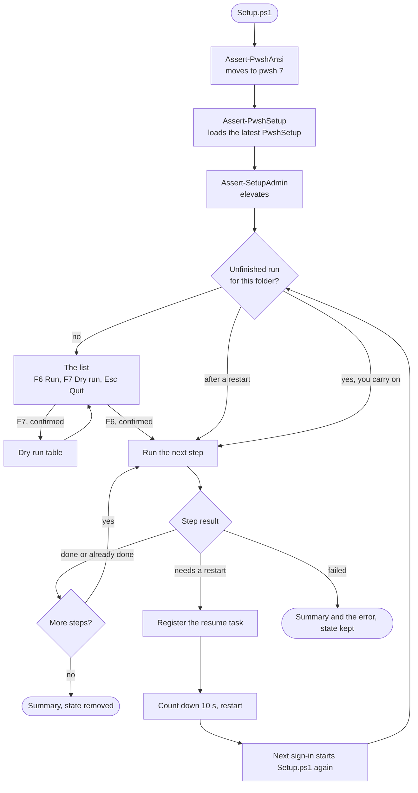

# Overview

PwshSetup runs a folder of ordered steps on Windows, and carries on across restarts by itself.  
It needs PowerShell 7.2 or later and [PwshAnsi](https://github.com/efthymios-ks/PwshAnsi) to draw.  
A script that starts it can begin on Windows PowerShell 5.1.  
Its guard lines are `Assert-PwshAnsi`, `Assert-PwshSetup` and `Assert-SetupAdmin`: the move to pwsh, the latest PwshSetup, and elevation.

## A setup

```
C:\Setup\
  Setup.ps1                     the guard lines, then Invoke-PwshSetup
  steps\                        the run: ordered items
    010-Install-Chocolatey.ps1    Use-SetupTemplate -Name 'Install-Chocolatey'
    020-Install-Git.ps1           Use-SetupTemplate -Name 'Install-Git'
    030-Install-ShopCert.ps1      Use-SetupTemplate -Name 'Install-ShopCert'
    040-Set-Wallpaper.ps1         a step written in place
  templates\                    your own templates, optional
    Install-ShopCert.ps1
```

Each item in `steps` is a published template by name, one of your own by name, or a step written in place.  
The numbers set the order; templates have none.  
See [`Use-SetupTemplate`](Use-SetupTemplate.md) and [`New-SetupStep`](New-SetupStep.md).

## How a run goes



1 - **List.**  
The folder's steps, in order, with what each installs and whether it restarts, read from the files without running them.  
F6 runs and F7 dry-runs, each after a y/n.  
`-Unattended` skips the list and runs.

2 - **Run.**  
Each step is checked right before it runs, and skipped when its Test says it is done.  
The screen shows a line per step and one bar:

```
✔ Install Chocolatey                    41.2s
· Install Git                           already done
  choco install visualstudio2026community --yes --no-progress
↻ Install Visual Studio 2026 Community  14m 03s  restart
████████████████░░░░░░░░░░░░░░  52%
```

3 - **Restart.**  
A step with `-RequiresRestart`, or one that calls `Request-SetupRestart`, ends the run after it.  
The run registers a scheduled task for the next sign-in of the same user, counts down ten seconds and restarts.  
Esc cancels the restart, and the next run asks to carry on.  
Signed back in, the task starts the same script with the same parameters, elevated, and the run carries on with no list and no questions.

4 - **Finish.**  
A summary table of every step, the total time and the number of restarts.  
A step that throws stops the run, with the error and the log path under the summary.  
The next run asks whether to carry on from it.

## What a run leaves on disk

| Where                                        | What                                                          |
| -------------------------------------------- | ------------------------------------------------------------- |
| `%ProgramData%\PwshSetup\Logs`               | One log per run, appended across its restarts.                |
| `%ProgramData%\PwshSetup\State`              | The run's steps and their results, per steps folder, until the run finishes. |
| Task Scheduler, `\PwshSetup\Resume`          | Only between a restart and the next sign-in.                  |

The log has every line a step writes, the full output of the commands it runs, and the errors:

```
2026-10-13 09:41:07  INFO    020-Install-Git  Started: Install Git
2026-10-13 09:41:07  INFO    020-Install-Git  choco install git --yes --no-progress
2026-10-13 09:41:31  OUTPUT  020-Install-Git  Chocolatey v2.4.1
2026-10-13 09:41:31  INFO    020-Install-Git  Done in 24.3s.
```

## Unattended, end to end

A restart needs someone to sign in before the run carries on.  
For a machine nobody sits at, turn on automatic sign-in for the setup account, as the [Hyper-V test machine](HyperV.md) does.

## Repository layout

```
src\                      the module, one file per public function
├── Assert-SetupAdmin.psm1    the loader, with Assert-PwshSetup.psm1: Windows PowerShell syntax
├── Invoke-PwshSetup.psm1     the run
├── Core.psm1                 internal: context, paths, log file
├── Steps.psm1                internal: loads step files and templates, runs Tests
├── State.psm1                internal: what a run remembers across restarts
├── Restart.psm1              internal: the resume task and the countdown
├── Shell.psm1                internal: the screens and keys
└── ...                       the other public functions
templates\                the published templates, unnumbered
demo\                     Show-SetupDemo.ps1 and its numbered steps
hyperv\                   the Hyper-V test machine scripts and a sample setup
tests\
├── unit\                     Pester 5 unit tests, run by Invoke-Test.ps1
└── system\templates\         per-template Pester 5 tests, run inside the test VM by Invoke-SystemTest.ps1
docs\                     these pages
Publish-SetupModule.ps1   build and publish
Invoke-Test.ps1           Pester 5 unit test runner
Invoke-SystemTest.ps1     runs the sample setup on the Hyper-V machine, then the system tests inside it
```

## Build

`Publish-SetupModule.ps1` merges `src` into three files and a folder:

| File                 | What                                                                   |
| -------------------- | ---------------------------------------------------------------------- |
| `PwshSetup.psm1`     | The loader. Windows PowerShell imports it and gets the bootstrap only: `Assert-PwshSetup`, `Assert-SetupAdmin`, `Test-SetupAdmin`. |
| `PwshSetupCore.ps1`  | Everything else, dot-sourced by the loader on pwsh 7.2+.               |
| `PwshSetup.psd1`     | The manifest. Requires PwshAnsi 0.1.9 or later.                        |
| `Templates\`         | The published templates.                                               |

The public functions are the ones the non-internal source files export.
